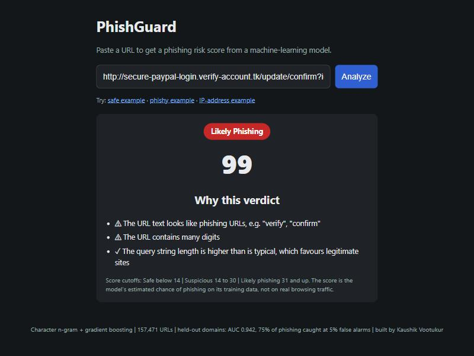
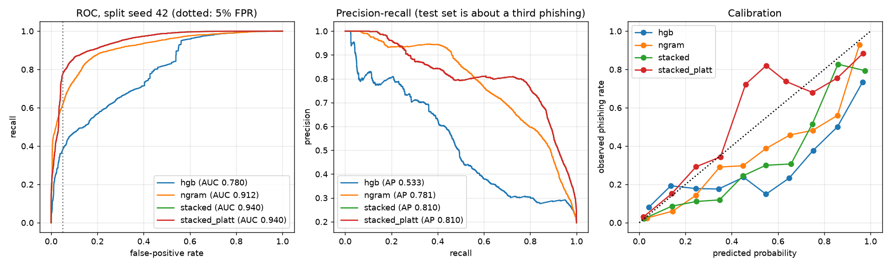

# PhishGuard

A machine-learning phishing URL detector. Paste a URL, get a risk score from 0 to 100, a verdict, and the three inputs that moved the model most. It works from the URL string alone: no page fetching, no DNS or WHOIS lookups.

**Live demo: https://phishguard-4qg7.onrender.com** (free hosting: the first visit after a quiet spell can take about a minute while the server wakes up)



This is a machine-learning project first and a detector second. The focus is on method: leakage-free splits, nested tuning, validation-chosen thresholds, calibration, model comparison across repeated splits, an independent check on data from outside the training pool, and honest reporting of where it fails and what each fix cost.

## How it works

```
URL string
   |
   v
normalize_for_model()        add missing scheme, drop leading "www."
   |
   +--------------------------------------+
   v                                      v
character 3-5-gram TF-IDF          31 engineered lexical features
+ logistic regression              (lengths, counts, entropy, TLD/keyword/host flags)
   |                                      |
   | out-of-fold probability              |
   +------------------+-------------------+
                      v
        gradient boosting (stacked)
                      v
           Platt calibration  ->  score 0-100
                      v
   verdict from thresholds chosen on validation data
```

- **Text model:** logistic regression over TF-IDF of character 3-5-grams of the raw URL. No hand-written features.
- **Engineered model:** 31 lexical features (`features.py`): sizes and counts, IP/port/punycode/`@` checks, subdomain count, digit ratios, token and digit-run lengths, hostname and path entropy, plus small lookup lists (suspicious TLDs, shorteners, keywords, free-hosting platforms, brand names).
- **Stacking:** gradient boosting on the engineered features plus the text model's out-of-fold probability, so it never sees a prediction made on its own training row.
- **Domain reweighting:** during training, all URLs from one registered domain and label share a total weight of at most 50, so a heavily abused platform (this data has 4,023 phishing URLs on `google.com`) counts like a mid-sized one. See [the trade-off](#down-weighting-large-domains-a-trade-off) below.
- **Calibration:** Platt scaling fitted on an unweighted validation split.
- **Verdicts:** "Likely phishing" and "Suspicious" are thresholds chosen on validation data at 5% and 10% false-positive rates. With the shipped model that is a score of **49+** for likely phishing and **20-48** for suspicious; the UI shows these cutoffs under every result. The score is the estimated chance of phishing *on this training mix* (35% phishing), not on real browsing traffic.
- **Explanations** are faithful to the stacked model: each of its 32 inputs is set in turn to the typical legitimate value, and the inputs that move the log-odds most are reported. When the text model's input is among them, it is illustrated with the URL tokens that drive the text model, counting only n-grams *inside* a token, so a token has the same sign in every URL. `http`, `https` and `www` are never shown as reasons. Tests check that reported impacts match recomputing the model and that a token's sign does not depend on its neighbours.

## Data

- **[Phishing URL dataset, Mendeley Data](https://data.mendeley.com/datasets/3jddhy2f6s)**, downloaded 2026-10-07: 128,228 URLs after removing duplicates (54,759 phishing, 73,469 legitimate). Legitimate URLs come from Common Crawl (pages, almost always with paths), phishing URLs from PhishTank.
- **Legitimate homepage supplement:** 24,993 bare homepages from the [Tranco](https://tranco-list.eu) top-1M list, sampled uniformly over the whole ranking (so mostly obscure sites), plus the homepages of the 4,250 legitimate sites already in the Mendeley data (which bring realistic subdomains).

Total: **157,471 URLs** (54,759 phishing, 102,712 legitimate). Raw files are not committed; see [data/README.md](data/README.md).

Why the supplement exists: in the Mendeley data alone, 93% of bare homepages (URLs with no path or query) are phishing, because the legitimate side was collected from crawled pages. The first models learned "bare homepage = phishing" and flagged ordinary sites. This was found by hand-testing (`https://boredbutton.com` scored 69, "likely phishing"). With the supplement, 44.6% of bare homepages are phishing, so having no path no longer decides the verdict.

## Evaluation protocol

- **Splits by registered domain.** No site appears in both train and test.
- **Nested.** For every outer split, hyperparameters, calibration and decision thresholds are chosen on a validation split drawn from the training domains. Test labels are never used for any choice.
- **Repeated.** The whole pipeline runs on 6 different outer splits (seeds 42, 0, 1, 2, 3, 4). Single splits are unreliable here because a few large domains dominate whichever test set they land in.
- **Sliced.** Results are reported separately for bare homepages and for URLs with a path or query.
- **Independent check** (`independent_check.py`): PhishTank URLs downloaded on 2026-10-07 and a held-out Tranco sample, keeping only domains that appear nowhere in the training pool.

## Results

### Repeated splits (mean ± std over 6 outer splits; threshold chosen on validation for a 5% false-positive target)

| Model | ROC-AUC | Recall | False-positive rate | AUC, bare homepages | AUC, URLs with paths |
|---|---|---|---|---|---|
| Engineered features only | 0.896 ± 0.054 | 58.9% | 5.5% | 0.923 | 0.886 |
| Character n-grams only | 0.895 ± 0.031 | 59.1% | 5.9% | 0.903 | 0.913 |
| **Stacked + Platt (shipped)** | **0.929 ± 0.031** | **76.1% ± 7.4** | 6.1% ± 2.2 | **0.944** | **0.934** |



Stacking has the best mean AUC and recall, at a slightly higher false-positive rate than either single model. The text model generalises better than the engineered features to phishing on platforms not seen in training: on one split, 975 phishing URLs on `adobe.com` were caught 0% of the time by the engineered model, 98% by the text model and 90% by the stacked model.

### Independent check: domains never seen in training

| | No homepage data | Homepage data | **Shipped (homepage data + domain reweighting)** |
|---|---|---|---|
| Legitimate homepages flagged "likely phishing" (5,000 unseen Tranco sites) | 62.1% | 0.68% | **0.28%** |
| Legitimate homepages flagged "suspicious" or worse | 95.6% | 2.3% | **1.2%** |
| Phishing caught, "likely phishing" (21,437 PhishTank URLs on 12,113 unseen domains) | 72.6% | **67.1%** | 61.8% |
| ... of which phishing URLs with paths | 62.9% | 70.0% | 63.4% |
| ... of which phishing bare homepages | 89.5% | 62.0% | 59.0% |
| Phishing caught, "suspicious" or worse | | 78.1% | 75.3% |

The first model's high recall on bare phishing homepages came from flagging nearly every homepage. False alarms on legitimate homepages are about equally low for popular and obscure sites (0.0% for the top 10k, 0.3% for ranks 100k-1M).

### Down-weighting large domains: a trade-off

Hand-testing found that the homepage-data model flagged `https://mail.google.com/mail/u/1/#inbox` at 70, "likely phishing". In the training data, `google.com` has 4,023 phishing URLs (abused Google Forms, Docs and Sites) and 56 legitimate ones, and "mail" is one of the strongest phishing signals (fake webmail logins). Capping each domain's training weight at 50 was tested and shipped, knowingly giving up some benchmark performance:

| | Homepage data, no reweighting | **Shipped (cap 50)** | Cap 10 |
|---|---|---|---|
| Repeated-split ROC-AUC | **0.945 ± 0.019** | 0.929 ± 0.031 | |
| Repeated-split recall (at ~6% FPR) | **79.5%** | 76.1% | |
| Unseen phishing caught (independent check) | **67.1%** | 61.8% | 63.4% |
| Unseen legitimate homepages flagged | 0.68% | **0.28%** | 0.30% |
| 22 everyday legitimate URLs flagged "likely phishing" | 7 | **1** | 3 |

Selected everyday URLs (score before → after): Gmail inbox 70 → 29, Google Drive 37 → 5, Google Docs 51 → 21, Outlook inbox 31 → 43 (still under the new cutoff of 49). Cap 10 was worse on both sides.

Why the two kinds of evidence disagree: the benchmark weighs every URL equally, so it is dominated by the same few heavily abused domains that the cap down-weights, and leaning on them pays off there. The cap helps with the URLs a person actually pastes. The benchmark loss is measured over 6 splits; the everyday gain rests on a hand-picked list of 22 URLs, so it is weaker evidence. I chose usability for the live demo.

## Limitations

- **Look-alike bare domains get through.** Unseen phishing that is a bare registered domain with no subdomain (like a made-up `paypa1-secure.com`) is caught only **11.7%** of the time (16% before domain reweighting), against 81% for bare phishing homepages with subdomains (`something.pages.dev`). All the legitimate homepages added from Tranco are bare registered domains, so "clean registered domain" became a signal of safety.
- **Well-known services are not recognised by name.** The model never saw a logged-in Gmail or Outlook URL (crawlers cannot log in), and phishing deliberately imitates these services. The Gmail inbox (29), Outlook inbox (43), `stackoverflow.com/questions` (47) and `store.steampowered.com` (41) land in "suspicious", and the generic `https://example.com/page` scores 52, "likely phishing".
- **Calibration is not solved.** Across splits, Platt scaling barely changes calibration error (0.059 after, against 0.068 for the raw stacked model; isotonic regression 0.063). The score is a ranking signal first and a probability second.
- **Precision collapses at realistic prevalence.** At the 5% false-positive operating point, precision is about 12% if only 1% of URLs are phishing.
- **The independent check is not fully independent.** PhishTank is also the upstream of the Mendeley phishing URLs (the check is domain-disjoint and later in time), and the legitimate side is Tranco, the same source as the homepage supplement. There is no independent source of legitimate URLs with paths.
- **Lexical only.** Page content, domain age and reputation are never inspected. Real products rely on exactly those to tell the real Gmail from a fake one.
- **Not a security product.** Treat the score as a signal, not a verdict.

## Development notes

| Version | Result | What was wrong / what changed |
|---|---|---|
| PhishTank + Tranco only, 16 features | 99.5% accuracy | Tranco has bare domains, PhishTank URLs have paths. The model learned "has a path = phishing" and scored `wikipedia.org` 100/100. |
| PhiUSIIL (UCI) | not trained | All legitimate URLs are `https://www.<domain>` with no path: the same kind of shortcut. |
| ISCX-URL-2016 feature CSVs | not usable | Pre-computed numeric features, no URL strings. |
| Mendeley, host-only features | 90.5% accuracy | Worked, but threw away path information. |
| Mendeley, 31 engineered features, one split | 87.6% accuracy, 91% recall | Optimistic: one favourable split, threshold chosen after the fact. Repeated splits showed AUC from 0.80 to 0.96. |
| Mendeley, stacked n-grams + features, nested protocol | AUC 0.971 ± 0.012 | Strong on held-out data, but flagged 62% of real-world homepages as phishing. Found by hand-testing `boredbutton.com`. Explanations also blamed meaningless tokens like `https` and `com`. |
| + legitimate homepage supplement, faithful explanations | AUC 0.945 ± 0.019, 0.68% homepage false alarms | Flagged a Gmail inbox URL as phishing, found by hand-testing. |
| **+ domain reweighting (cap 50)** | **AUC 0.929 ± 0.031, 0.28% homepage false alarms** | Current model: fewer false alarms on everyday URLs, lower benchmark recall. |

## Run locally

```bash
python -m venv .venv
.venv/Scripts/python -m pip install -r requirements.txt   # on macOS/Linux: .venv/bin/python
.venv/Scripts/python -m pytest -q
.venv/Scripts/python -m uvicorn app:app --port 8000
```

Open http://localhost:8000.

To retrain, place the data files in `data/` (see [data/README.md](data/README.md)) and run `python train.py` (about 10 minutes; `--domain-cap 0` turns off domain reweighting). To reproduce the comparison, run `pip install -r requirements-eval.txt` and then `python evaluate.py` (writes `model/evaluation.json` and `model/evaluation.png`) and `python independent_check.py` (writes `model/independent.json`).

## API

`POST /predict` with `{ "url": "https://amaz0n-account-verify.pages.dev/login" }` returns:

```json
{
  "score": 100,
  "verdict": "likely_phishing",
  "top_features": [
    {"feature": "url_text", "value": 0.999, "impact": 6.288, "direction": "phishing", "explanation": "The URL text looks like phishing URLs, e.g. \"verify\", \"login\"", "examples": ["verify", "login"]},
    {"feature": "hostname_length", "value": 31, "impact": 1.729, "direction": "phishing", "explanation": "The domain name is unusually long"},
    {"feature": "path_length", "value": 6, "impact": 0.763, "direction": "phishing", "explanation": "The path length is lower than is typical for legitimate sites"}
  ]
}
```

`impact` is how far the stacked model's log-odds would drop if that input took its typical legitimate value. Verdicts are `safe`, `suspicious` or `likely_phishing`. `GET /info` returns the training summary from `model/metrics.json`.

## Project layout

```
features.py           URL -> 31 engineered features; URL normalisation
modeling.py           n-gram model, stacking, domain reweighting, tuning, calibration, thresholds
train.py              builds the dataset, trains and saves the deployable model, reports held-out metrics
evaluate.py           repeated grouped-split comparison of all models, with homepage/path slices
independent_check.py  scores PhishTank and Tranco data from outside the training pool
app.py                FastAPI app: /predict, /info, serves the UI; faithful explanations
static/               single-page frontend (HTML/CSS/JS, mobile-friendly)
tests/                pytest: feature extraction, API contract, explanation correctness
model/                trained model, metrics, evaluation results and figure
data/                 dataset notes (raw data not committed)
docs/                 screenshot for this README
Dockerfile            container image (deployed on Render; listens on $PORT, default 7860)
```

## Built by

Kaushik Vootukur
